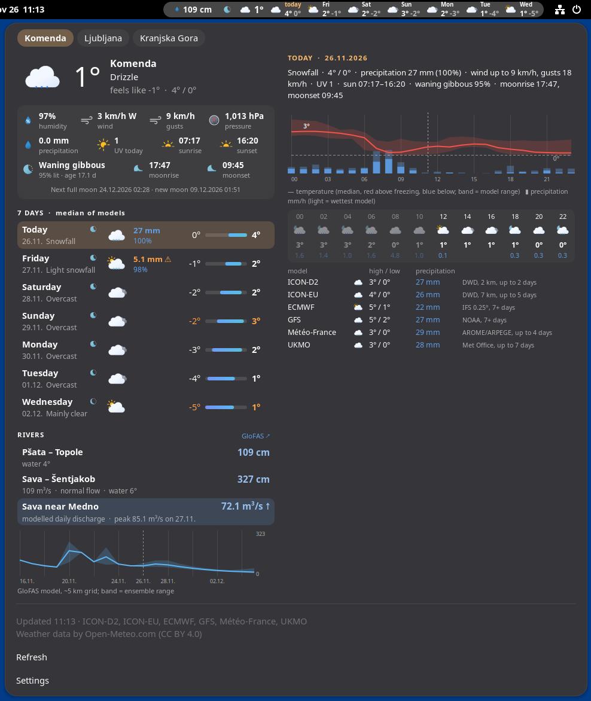
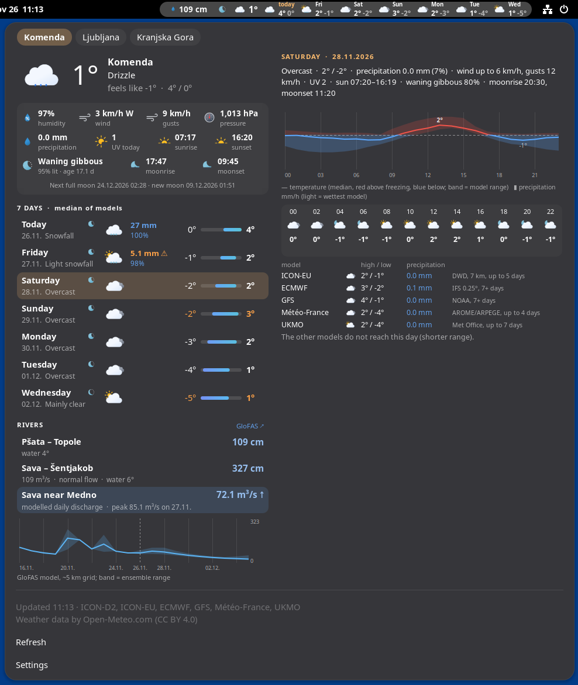
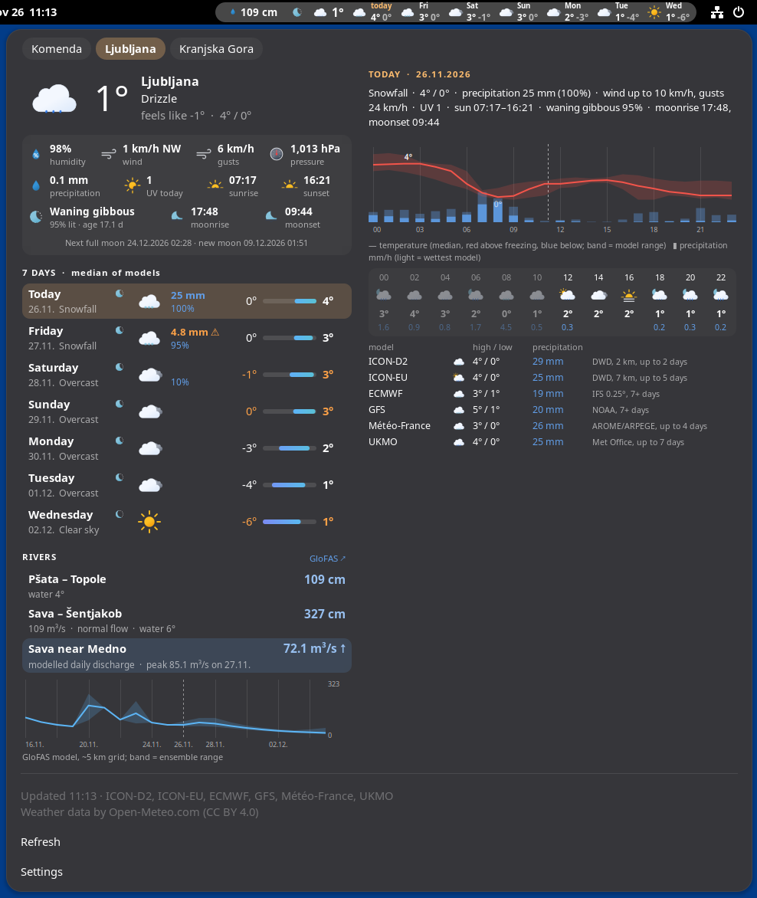
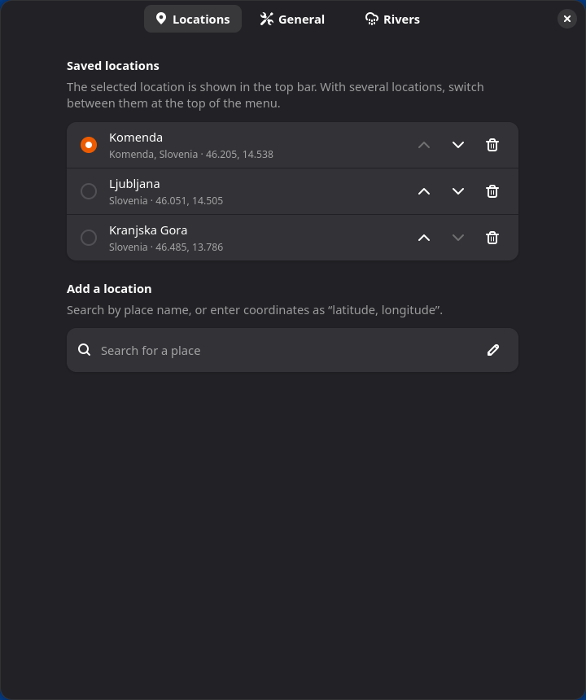
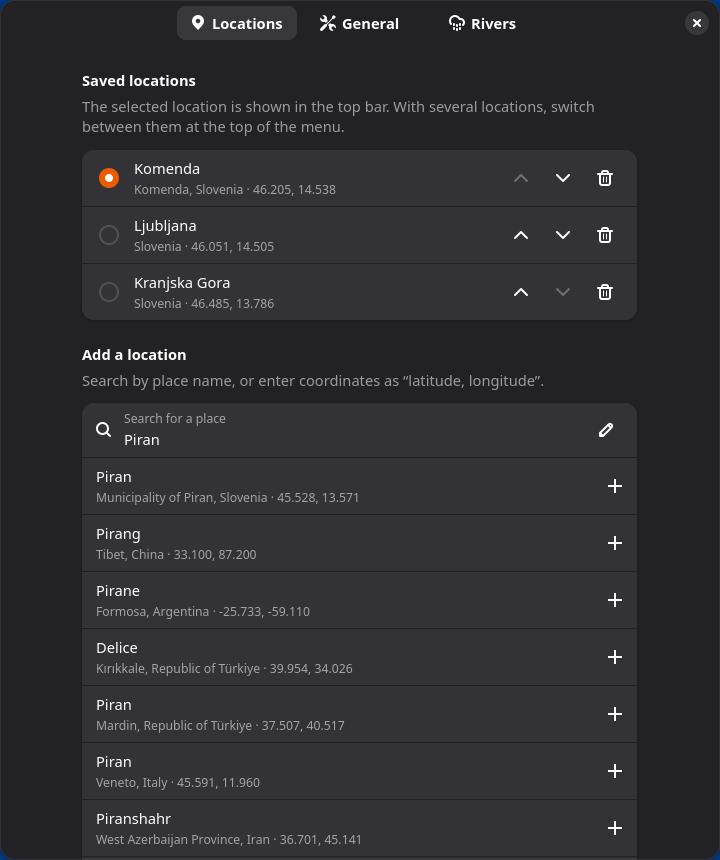
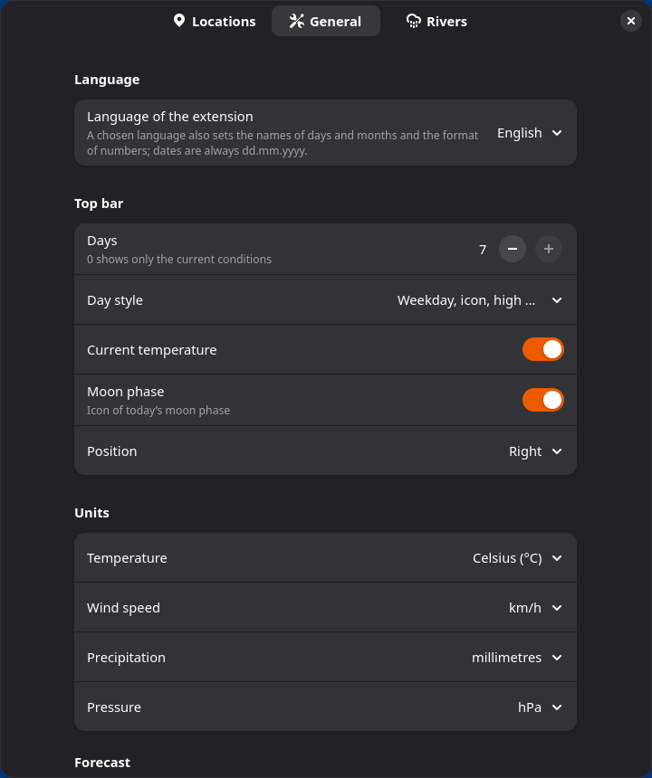
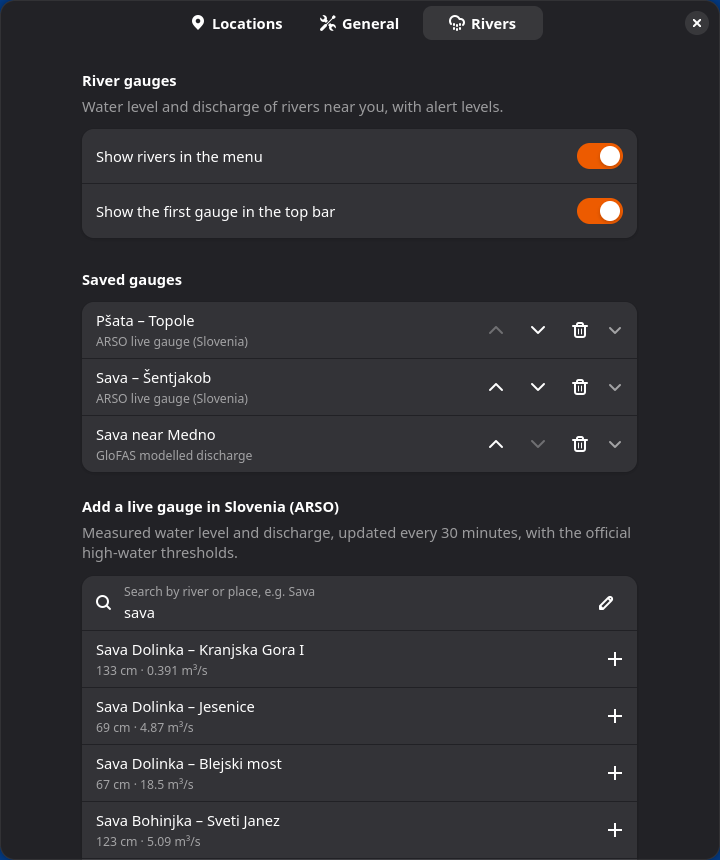
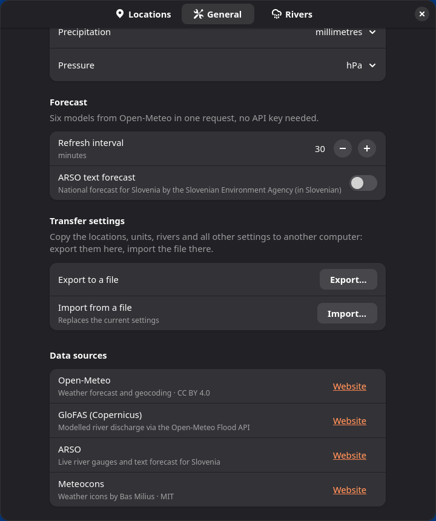

<!--
SPDX-FileCopyrightText: 2026 Uroš Kristan <uros.kristan@gmail.com>
SPDX-License-Identifier: Apache-2.0
-->

# Urosk Weather Indicator

**English** · [Slovenščina](README.sl.md)

A GNOME Shell extension that puts a **multi-model weather forecast** in the top bar. Instead of
trusting a single weather model, it asks Open-Meteo for six of them at once, shows the
**median**, draws the **range** between the models and **warns you when they disagree** — so you
can see at a glance whether "rain on Thursday" is a safe bet or a coin toss.




## Features

- **Six weather models in one request** — ICON-D2, ICON-EU, ECMWF, GFS, Météo-France and UKMO via
  [Open-Meteo](https://open-meteo.com). No API key, no account.  
- **Median and range** for every value; the hourly chart shows the model spread as a band, red above
  0 °C and blue below, with a dashed line at 0 °C.  
- **Disagreement warnings** when the models differ by 4 °C or more, or when some say "rain" and
  others "dry".  
- **Top bar** with the current temperature and up to seven days (full or compact).  
- **Menu** with current conditions (humidity, wind, gusts, pressure, UV, sunrise and sunset),
  a 7-day list with temperature bars, and for the selected day an hourly chart, an hourly strip
  and the forecast of each model.  
- **Moon** — phase with icon, illuminated fraction, age, moonrise and moonset for the selected
  location, and the date and time of the next full and new moon; a small phase icon for every day
  of the 7-day list and, if you want it, in the top bar. Computed on your computer from the
  coordinates (Meeus' lunar theory, phases within a minute) — no extra requests.  
- **Several locations**, found with a place search (or entered as coordinates); switch between
  them at the top of the menu. Times are shown in each location's own time zone.  
- **Rivers** (optional):  
  - **anywhere in the world** — modelled daily river discharge with a 10-day ensemble forecast
    from GloFAS (Copernicus), via the Open-Meteo Flood API;  
  - **live gauges in Slovenia** — measured water level, discharge and water temperature from
    ARSO, refreshed every 30 minutes, with the official high-water thresholds, a trend arrow and
    a 48-hour chart.  
  - Yellow / orange / red alert levels, with your own thresholds if you want them.  
- **Units**: °C or °F, km/h, m/s, mph or knots, mm or inches, hPa, inHg or mmHg; the 12/24-hour
  clock follows your GNOME setting.  
- Optional national **text forecast for Slovenia** (ARSO, in Slovenian).  
- **English and Slovenian** — follows the desktop language, or choose the language in the
  settings (it also sets the names of days and months and the number format). Dates are always
  written as dd.mm.yyyy.  
- **Easy install and update** with one command, and **settings transfer** to another computer
  (export and import as a file).  
- Works with the dark and the light shell style.

## Screenshots

| Another day selected | Another location |
| --- | --- |
|  |  |

| Locations | Place search |
| --- | --- |
|  |  |

| General | Rivers |
| --- | --- |
|  |  |

| Settings transfer | |
| --- | --- |
|  | |

The screenshots are generated from live data by `scripts/screenshots.sh` (see
[Development](#development)).

## Installation

Requires **GNOME Shell 48, 49 or 50**.

### With one command (install or update)

```sh
curl -fsSL https://raw.githubusercontent.com/urkl/urosk-weather-indicator/main/scripts/install-latest.sh | bash
```

The [script](scripts/install-latest.sh) downloads the latest release, checks its SHA256
checksum and the supported GNOME Shell versions, installs it for your user with
`gnome-extensions install --force` (no sudo) and enables it on the first install. Run the same
command to update. Then log out and back in: on Wayland GNOME Shell loads extensions only at
login. Options: `… | bash -s -- --version 1.1.0` for a particular release, `--file path.zip`
for a downloaded package.

### From a release

Download `urosk-weather-indicator@urosk.net.shell-extension.zip` from the
[releases](https://github.com/urkl/urosk-weather-indicator/releases), then:

```sh
gnome-extensions install --force urosk-weather-indicator@urosk.net.shell-extension.zip
```

Log out and back in (on Wayland GNOME Shell loads new extensions only at login), then:

```sh
gnome-extensions enable urosk-weather-indicator@urosk.net
```

### From source

```sh
git clone https://github.com/urkl/urosk-weather-indicator.git
cd urosk-weather-indicator
make install
```

`make install` needs `glib-compile-schemas` (package `libglib2.0-bin` on Debian/Ubuntu,
`glib2` on Fedora) and Python 3. Log out and in, then enable it as above.

### Updating keeps your settings

Settings are stored in dconf under `/org/gnome/shell/extensions/urosk-weather-indicator/`, not
in the extension folder, so an update — with the script, `gnome-extensions install --force` or
`make install` — keeps your locations, units and rivers; new settings start with their defaults.
Only *removing* the extension in the Extensions app may reset them.

## Usage

1. Open **Settings** from the menu (or `gnome-extensions prefs urosk-weather-indicator@urosk.net`).  
2. On the **Locations** page, search for a place and click it to add it. You can also type
   coordinates, e.g. `46.2048, 14.5384`. The selected location is shown in the top bar; with more
   than one location, switch at the top of the menu.  
3. Click a day in the menu to see its hourly chart and what each model expects.  
4. On the **General** page you can choose the language (English or Slovenian), units and what
   the top bar shows.  
5. Optionally, on the **Rivers** page, add a live ARSO gauge (search by river or place) or any
   river point worldwide (search for a place on the river), and set your own alert thresholds.  
6. To use the same settings on another computer, click **Export…** under *Transfer settings* on
   the **General** page, then **Import…** the file on the other computer (it replaces the
   settings there). The same from a terminal:

   ```sh
   dconf dump /org/gnome/shell/extensions/urosk-weather-indicator/ > uwi-settings.ini
   dconf load /org/gnome/shell/extensions/urosk-weather-indicator/ < uwi-settings.ini
   ```

## How the forecast is combined

For every hour and every day the extension takes the values of all models that cover the
location and shows the **median**; the **minimum and maximum** are the band in the hourly chart
and appear in the warnings. Weather symbols are combined by severity (the median severity wins).
A day is marked uncertain (⚠, orange) when:

- the high or low temperature differs by **4 °C or more** between models, or  
- precipitation differs a lot — some models are dry (< 0.5 mm) while others expect 3 mm or more,
  or the spread is at least 4 mm and half the median.

ICON-D2 (2 days) and ICON-EU (5 days) are regional European models; outside Europe and on later
days the median is built from the remaining models.

## Rivers

| | GloFAS (worldwide) | ARSO (Slovenia) |
| --- | --- | --- |
| What | modelled daily discharge, m³/s | measured water level (cm), discharge, water temperature |
| Updates | daily model run; past 10 days and a 10-day ensemble forecast | every 30 minutes |
| Alert thresholds | your own (discharge) | official high-water thresholds, or your own (water level) |
| Chart | daily median with the ensemble range | last 48 hours of water level |

GloFAS uses a grid of about 5 km, so pick a point on the river itself; small streams may not be
represented. ARSO only publishes the latest reading, so the extension keeps the readings it has
seen (72 hours) in `~/.cache/urosk-weather-indicator/arso-history.json`; the 48-hour chart and the
trend arrow fill in over time.

## Privacy

The extension makes anonymous HTTPS requests to public services only — no API keys, no accounts,
no tracking:

| Service | Sent | When |
| --- | --- | --- |
| `api.open-meteo.com` | coordinates of the selected location | every refresh (default 30 min) and when switching locations |
| `geocoding-api.open-meteo.com` | the text you type in a search box | while searching in the settings |
| `flood-api.open-meteo.com` | coordinates of your GloFAS river points | at most every 6 hours |
| `www.arso.gov.si`, `meteo.arso.gov.si` | nothing (a fixed file is downloaded) | every 10 minutes if ARSO gauges are saved; hourly for the text forecast |

The moon phase, moonrise and moonset are computed locally; nothing is sent for them. Settings are
stored in GSettings (dconf); the ARSO reading history in your cache directory. An exported
settings file contains your locations (coordinates), so share it only where you would share
those.

## Data sources and attribution

- Weather forecast and geocoding: [Open-Meteo.com](https://open-meteo.com/), licensed under
  [CC BY 4.0](https://creativecommons.org/licenses/by/4.0/); geocoding is based on
  [GeoNames](https://www.geonames.org/).  
- River discharge: [Open-Meteo Flood API](https://open-meteo.com/en/docs/flood-api); contains
  modified Copernicus Emergency Management Service information
  ([GloFAS](https://global-flood.emergency.copernicus.eu/)).  
- River gauges and text forecast for Slovenia: [ARSO](https://www.arso.gov.si/), the Slovenian
  Environment Agency.  
- Weather icons: [Meteocons](https://github.com/basmilius/weather-icons) by Bas Milius, MIT licence
  (`src/icons/LICENSE-meteocons`).

The extension shows the Open-Meteo attribution in the menu. Forecasts are model output and can
be wrong; for warnings that matter, follow your national weather and hydrological service.

## Translations

The extension follows the desktop language; Settings → General → Language overrides it.
Translations live in `po/`. To add a language (example: German):

```sh
cp po/urosk-weather-indicator.pot po/de.po   # set "Language: de" and the Plural-Forms header
echo de >> po/LINGUAS
# translate the msgstr entries, then:
make i18n-check
```

After changing user-visible strings, run `make pot` to refresh the template and the `.po` files.

## Development

```text
src/                  the extension (what is installed)
  extension.js        enable/disable, adds the indicator to the top bar
  prefs.js            preferences window
  lib/                pure modules: forecast, statistics, formatting, rivers, geocoding, charts
  ui/                 top bar and menu (GNOME Shell St widgets)
  prefs/              preference pages (GTK 4 / libadwaita)
  schemas/            GSettings schema
  icons/              Meteocons SVG icons
po/                   translation template and translations
tests/                unit tests for src/lib, run with GJS, using real API responses as fixtures
scripts/              i18n and release tooling, screenshot automation
```

| Command | What it does |
| --- | --- |
| `make test` | unit tests (`gjs -m tests/run.js` and Python `tests/test_*.py`) |
| `npm ci && make lint` | ESLint |
| `make i18n-check` | every string translated, template up to date |
| `make install` | build and install for the current user |
| `make zip` | package `dist/urosk-weather-indicator@urosk.net.shell-extension.zip` and `dist/SHA256SUMS` |
| `make release-check` | everything a release needs: `make check`, `make zip`, versions and CHANGELOG |
| `make screenshots` | regenerate `docs/screenshots/` (English) and `docs/screenshots/sl/` (Slovenian) |

`scripts/screenshots.sh` starts a **headless GNOME Shell** with its own D-Bus session and
temporary config directories (your desktop is not touched), installs the extension together with
a small helper extension, waits for live data, opens the menu and the preferences and saves the
screenshots. It doubles as an end-to-end check: it fails if the extension does not load data.

### Releasing a new version

Releases are built and published by GitHub Actions
([`release.yml`](.github/workflows/release.yml)) when a tag `vX.Y.Z` is pushed:

1. Set the version in `src/metadata.json` (`version-name`) and in `package.json`: `npm version X.Y.Z --no-git-tag-version` also updates `package-lock.json`.  
2. Add a section `## [X.Y.Z] — YYYY-MM-DD` to `CHANGELOG.md`; it becomes the text of the release.  
3. `make release-check` runs every check of the workflow and writes the notes to `build/release-notes.md`.  
4. Commit, then tag and push: `git tag -a vX.Y.Z -m "Urosk Weather Indicator X.Y.Z" && git push origin main vX.Y.Z`.

The workflow runs lint, tests and the translation check, `make zip`, and checks that the versions
and the CHANGELOG match the tag. It then publishes the release with both files from `make zip` as
assets (`urosk-weather-indicator@urosk.net.shell-extension.zip` and `SHA256SUMS`, the names
`scripts/install-latest.sh` downloads) and checks them from the public URLs. It uses only the
repository's own `GITHUB_TOKEN`; the build runs with read access, only publishing can write.

An existing release is never replaced. *Actions → Release → Run workflow* releases a pushed tag
that has no release yet, or with *Dry run* builds and checks a tag without publishing anything
(the files are kept as the artifact of the run).

To debug the extension in a nested session:

```sh
make install
dbus-run-session -- gnome-shell --devkit --wayland
```

## License

Copyright 2026 Uroš Kristan. Licensed under the [Apache License, Version 2.0](LICENSE); see also
[NOTICE](NOTICE). The Meteocons icons are licensed under the MIT licence.
