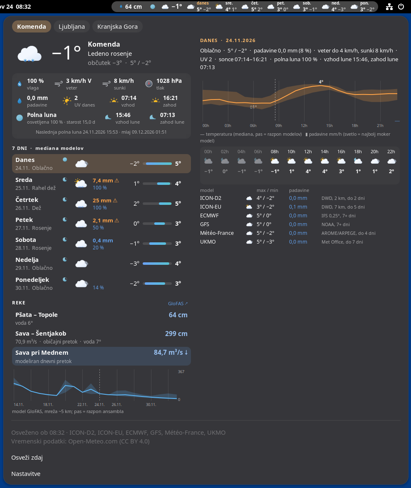
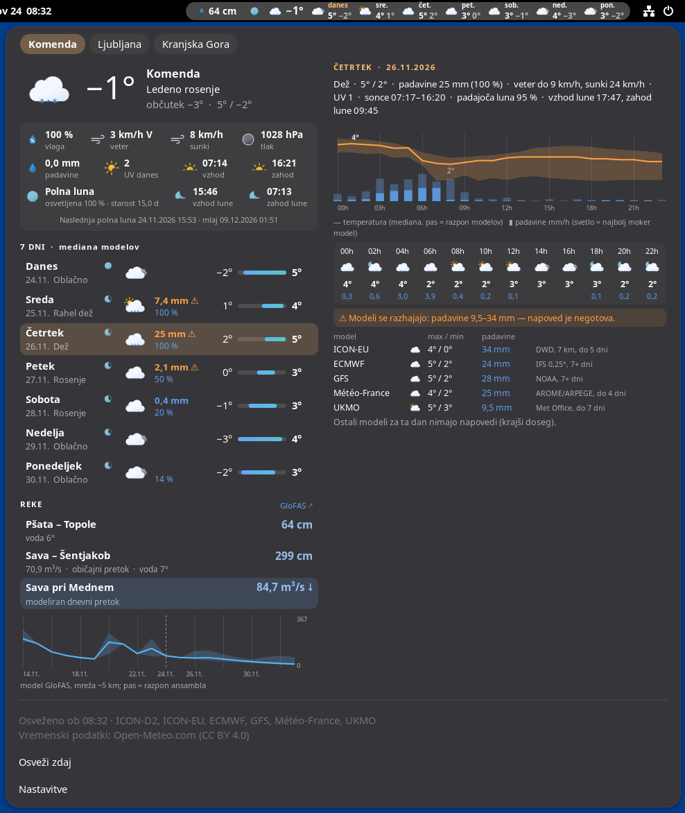
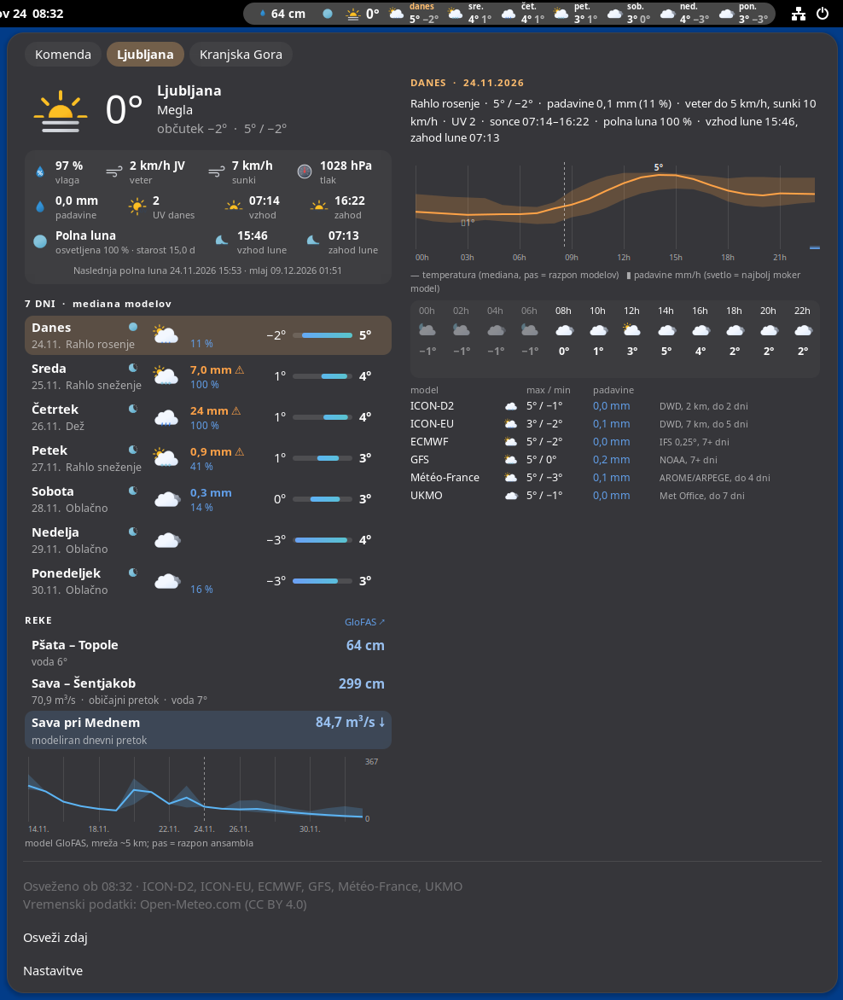
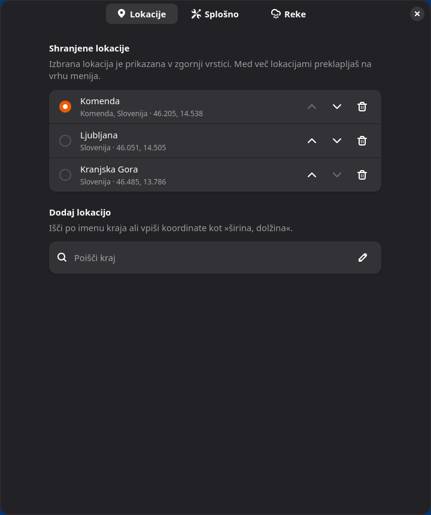
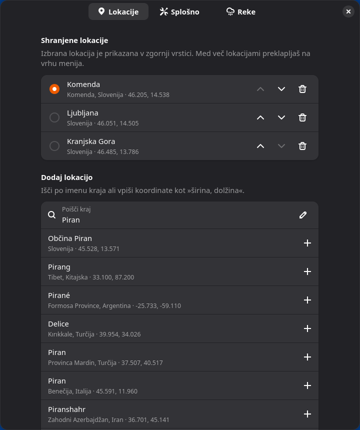
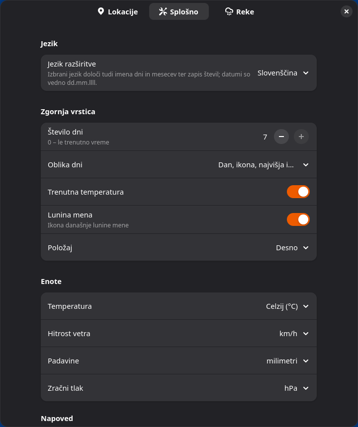
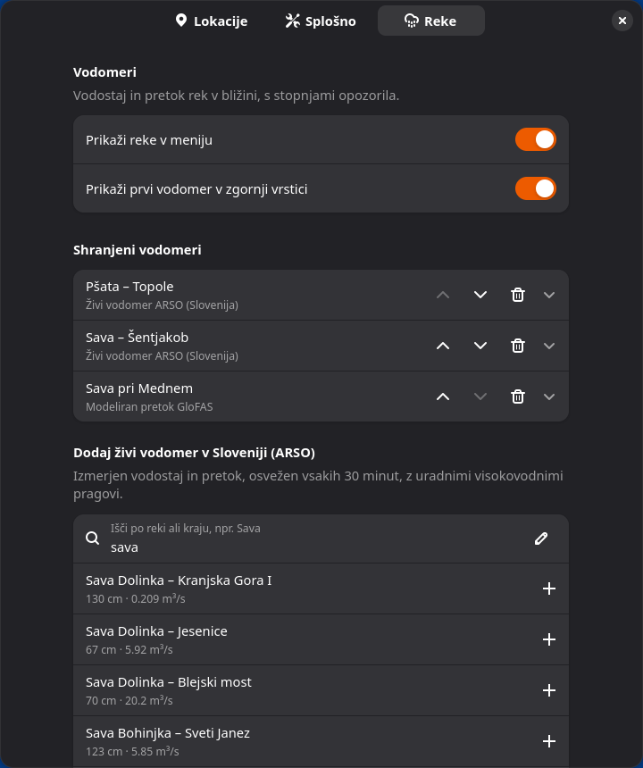
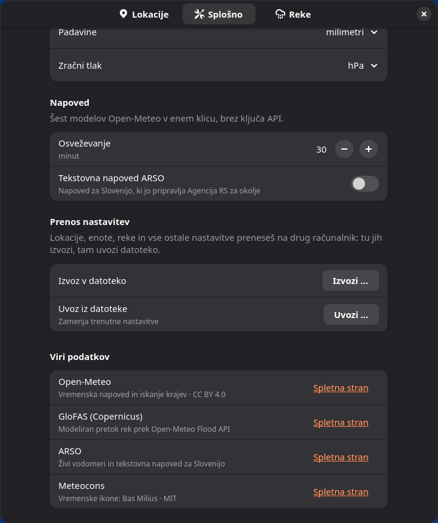

<!--
SPDX-FileCopyrightText: 2026 Uroš Kristan <uros.kristan@gmail.com>
SPDX-License-Identifier: Apache-2.0
-->

# Urosk Weather Indicator

[English](README.md) · **Slovenščina**

Razširitev za GNOME Shell, ki v zgornjo vrstico postavi **vremensko napoved več modelov**. Namesto
da bi verjela enemu modelu, od Open-Meteo hkrati vpraša šest modelov, pokaže **mediano**, nariše
**razpon** med modeli in **opozori, ko se modeli razhajajo** — tako na prvi pogled vidiš, ali je
»dež v četrtek« zanesljiv ali met kovanca.




## Kaj zna

- **Šest vremenskih modelov v enem klicu** — ICON-D2, ICON-EU, ECMWF, GFS, Météo-France in UKMO prek
  [Open-Meteo](https://open-meteo.com). Brez ključa API, brez računa.  
- **Mediana in razpon** za vsako vrednost; urni graf razpon modelov pokaže kot pas.  
- **Opozorilo ob razhajanju**, ko se modeli razlikujejo za 4 °C ali več ali ko eni napovedujejo
  dež, drugi pa suho.  
- **Zgornja vrstica** s trenutno temperaturo in do sedmimi dnevi (polno ali kratko).  
- **Meni** s trenutnim vremenom (vlaga, veter, sunki, tlak, UV, vzhod in zahod sonca), seznamom
  sedmih dni s temperaturnimi trakovi, za izbrani dan pa z urnim grafom, urnim trakom in napovedjo
  vsakega modela.  
- **Luna** — mena z ikono, osvetljenost, starost, vzhod in zahod lune za izbrano lokacijo ter datum
  in ura naslednje polne lune in mlaja; majhna ikona mene ob vsakem dnevu v seznamu sedmih dni in
  po želji v zgornji vrstici. Izračuna se na tvojem računalniku iz koordinat (Meeusova teorija
  Lune, mene na minuto natančno) — brez dodatnih zahtev.  
- **Več lokacij**, ki jih poiščeš po imenu kraja (ali vpišeš koordinate); med njimi preklapljaš na
  vrhu menija. Časi so v časovnem pasu posamezne lokacije.  
- **Reke** (neobvezno):  
  - **kjer koli na svetu** — modeliran dnevni pretok z 10-dnevno napovedjo ansambla iz GloFAS
    (Copernicus) prek Open-Meteo Flood API;  
  - **živi vodomeri v Sloveniji** — izmerjen vodostaj, pretok in temperatura vode iz ARSO, osveženo
    vsakih 30 minut, z uradnimi visokovodnimi pragovi, puščico trenda in grafom zadnjih 48 ur.  
  - Rumena, oranžna in rdeča stopnja opozorila, po želji z lastnimi pragovi.  
- **Enote**: °C ali °F, km/h, m/s, mph ali vozli, mm ali palci, hPa, inHg ali mmHg; 12- ali
  24-urna ura sledi nastavitvi GNOME.  
- Neobvezna **tekstovna napoved za Slovenijo** (ARSO).  
- **Slovenščina in angleščina** — sledi jeziku namizja ali pa jezik izbereš v nastavitvah (določi
  tudi imena dni in mesecev ter zapis števil). Datumi so vedno zapisani kot dd.mm.llll.  
- **Preprosta namestitev in posodobitev** z enim ukazom ter **prenos nastavitev** na drug
  računalnik (izvoz in uvoz datoteke).  
- Deluje s temnim in svetlim slogom lupine.

## Posnetki zaslona

| Izbran drug dan | Druga lokacija |
| --- | --- |
|  |  |

| Lokacije | Iskanje kraja |
| --- | --- |
|  |  |

| Splošno | Reke |
| --- | --- |
|  |  |

| Prenos nastavitev | |
| --- | --- |
|  | |

Posnetki nastanejo samodejno iz živih podatkov s skripto `scripts/screenshots.sh` (glej
[Razvoj](#razvoj)).

## Namestitev

Potrebuje **GNOME Shell 48, 49 ali 50**.

### Z enim ukazom (namestitev ali posodobitev)

```sh
curl -fsSL https://raw.githubusercontent.com/urkl/urosk-weather-indicator/main/scripts/install-latest.sh | bash
```

[Skripta](scripts/install-latest.sh) prenese zadnjo izdajo, preveri njeno kontrolno vsoto SHA256
in podprte različice GNOME Shell, jo z `gnome-extensions install --force` namesti za tvojega
uporabnika (brez sudo) in jo ob prvi namestitvi vklopi. Za posodobitev poženeš isti ukaz. Nato se
odjavi in znova prijavi: na Waylandu GNOME Shell naloži razširitve le ob prijavi. Možnosti:
`… | bash -s -- --version 1.1.0` za določeno izdajo, `--file pot.zip` za že prenesen paket.

### Iz izdaje

Prenesi `urosk-weather-indicator@urosk.net.shell-extension.zip` z
[izdaj](https://github.com/urkl/urosk-weather-indicator/releases), nato:

```sh
gnome-extensions install --force urosk-weather-indicator@urosk.net.shell-extension.zip
```

Odjavi se in znova prijavi (na Waylandu GNOME Shell nove razširitve naloži šele ob prijavi), nato:

```sh
gnome-extensions enable urosk-weather-indicator@urosk.net
```

### Iz izvorne kode

```sh
git clone https://github.com/urkl/urosk-weather-indicator.git
cd urosk-weather-indicator
make install
```

`make install` potrebuje `glib-compile-schemas` (paket `libglib2.0-bin` na Debianu/Ubuntuju,
`glib2` na Fedori) in Python 3. Odjavi se, prijavi in razširitev vklopi kot zgoraj.

### Posodobitev ohrani nastavitve

Nastavitve so shranjene v dconf pod `/org/gnome/shell/extensions/urosk-weather-indicator/`, ne v
mapi razširitve, zato posodobitev — s skripto, z `gnome-extensions install --force` ali z
`make install` — ohrani lokacije, enote in reke; nove nastavitve začnejo s privzetimi vrednostmi.
Ponastavi jih lahko le *odstranitev* razširitve v aplikaciji Razširitve.

## Uporaba

1. V meniju odpri **Nastavitve** (ali `gnome-extensions prefs urosk-weather-indicator@urosk.net`).  
2. Na strani **Lokacije** poišči kraj in ga s klikom dodaj. Vpišeš lahko tudi koordinate, npr.
   `46.2048, 14.5384`. Izbrana lokacija je v zgornji vrstici; pri več lokacijah preklapljaš na
   vrhu menija.  
3. Klikni dan v meniju in vidiš njegov urni graf ter kaj pričakuje posamezni model.  
4. Na strani **Splošno** izbereš jezik (slovenščina ali angleščina), enote in kaj kaže zgornja
   vrstica.  
5. Po želji na strani **Reke** dodaš živi vodomer ARSO (iskanje po reki ali kraju) ali katero koli
   točko na reki kjer koli na svetu (iskanje kraja ob reki) in nastaviš lastne pragove opozoril.  
6. Za iste nastavitve na drugem računalniku na strani **Splošno** pod *Prenos nastavitev* klikni
   **Izvozi …**, na drugem računalniku pa datoteko **Uvozi …** (zamenja tamkajšnje nastavitve).
   Enako v terminalu:

   ```sh
   dconf dump /org/gnome/shell/extensions/urosk-weather-indicator/ > uwi-nastavitve.ini
   dconf load /org/gnome/shell/extensions/urosk-weather-indicator/ < uwi-nastavitve.ini
   ```

## Kako se združi napoved

Za vsako uro in vsak dan razširitev vzame vrednosti vseh modelov, ki pokrivajo lokacijo, in pokaže
**mediano**; **najmanjša in največja** vrednost sta pas v urnem grafu in se pojavita v opozorilih.
Vremenski simboli se združijo po resnosti (zmaga srednja resnost). Dan je označen kot negotov
(⚠, oranžno), kadar:

- se najvišja ali najnižja temperatura med modeli razlikuje za **4 °C ali več** ali  
- se padavine močno razlikujejo — nekateri modeli so suhi (< 0,5 mm), drugi pričakujejo 3 mm ali
  več, ali pa je razpon vsaj 4 mm in polovica mediane.

ICON-D2 (2 dni) in ICON-EU (5 dni) sta regionalna evropska modela; zunaj Evrope in v kasnejših dneh
se mediana izračuna iz preostalih modelov.

## Reke

| | GloFAS (ves svet) | ARSO (Slovenija) |
| --- | --- | --- |
| Kaj | modeliran dnevni pretok, m³/s | izmerjen vodostaj (cm), pretok, temperatura vode |
| Osveževanje | dnevni zagon modela; zadnjih 10 dni in 10-dnevna napoved ansambla | vsakih 30 minut |
| Pragovi opozoril | lastni (pretok) | uradni visokovodni pragovi ali lastni (vodostaj) |
| Graf | dnevna mediana z razponom ansambla | vodostaj zadnjih 48 ur |

GloFAS uporablja mrežo približno 5 km, zato izberi točko na sami reki; manjši potoki morda niso
zajeti. ARSO objavi le zadnjo meritev, zato razširitev meritve, ki jih je videla (72 ur), hrani v
`~/.cache/urosk-weather-indicator/arso-history.json`; graf 48 ur in puščica trenda se sčasoma
zapolnita.

## Zasebnost

Razširitev pošilja le anonimne zahteve HTTPS javnim storitvam — brez ključev API, brez računov,
brez sledenja:

| Storitev | Kaj pošlje | Kdaj |
| --- | --- | --- |
| `api.open-meteo.com` | koordinate izbrane lokacije | ob vsakem osveževanju (privzeto 30 min) in ob menjavi lokacije |
| `geocoding-api.open-meteo.com` | besedilo, ki ga vtipkaš v iskalno polje | med iskanjem v nastavitvah |
| `flood-api.open-meteo.com` | koordinate tvojih točk GloFAS | največ vsakih 6 ur |
| `www.arso.gov.si`, `meteo.arso.gov.si` | nič (prenese se stalna datoteka) | vsakih 10 minut, če so shranjeni vodomeri ARSO; tekstovna napoved vsako uro |

Luna (mena, vzhod in zahod) se izračuna lokalno; zanjo se ne pošlje nič. Nastavitve so shranjene v
GSettings (dconf), zgodovina meritev ARSO pa v mapi s predpomnilnikom. Izvožena datoteka z
nastavitvami vsebuje tvoje lokacije (koordinate), zato jo deli le tam, kjer bi delil te.

## Viri podatkov in navedba avtorstva

- Vremenska napoved in iskanje krajev: [Open-Meteo.com](https://open-meteo.com/), licenca
  [CC BY 4.0](https://creativecommons.org/licenses/by/4.0/); iskanje krajev temelji na
  [GeoNames](https://www.geonames.org/).  
- Pretok rek: [Open-Meteo Flood API](https://open-meteo.com/en/docs/flood-api); vsebuje spremenjene
  informacije storitve Copernicus Emergency Management Service
  ([GloFAS](https://global-flood.emergency.copernicus.eu/)).  
- Vodomeri in tekstovna napoved za Slovenijo: [ARSO](https://www.arso.gov.si/), Agencija Republike
  Slovenije za okolje.  
- Vremenske ikone: [Meteocons](https://github.com/basmilius/weather-icons), avtor Bas Milius, licenca
  MIT (`src/icons/LICENSE-meteocons`).

Razširitev navedbo Open-Meteo pokaže v meniju. Napovedi so izhod modelov in se lahko zmotijo; pri
opozorilih, ki so pomembna, upoštevaj državno vremensko in hidrološko službo.

## Prevodi

Razširitev sledi jeziku namizja; v Nastavitve → Splošno → Jezik ga lahko izbereš sam. Prevodi so v
mapi `po/`. Nov jezik (primer: nemščina) dodaš tako:

```sh
cp po/urosk-weather-indicator.pot po/de.po   # nastavi glavi "Language: de" in Plural-Forms
echo de >> po/LINGUAS
# prevedi vnose msgstr, nato:
make i18n-check
```

Ko spremeniš besedila v vmesniku, z `make pot` osveži predlogo in datoteke `.po`.

## Razvoj

```text
src/                  razširitev (to se namesti)
  extension.js        vklop in izklop, doda indikator v zgornjo vrstico
  prefs.js            okno z nastavitvami
  lib/                čisti moduli: napoved, statistika, oblikovanje, reke, iskanje krajev, grafi
  ui/                 zgornja vrstica in meni (gradniki St v GNOME Shell)
  prefs/              strani nastavitev (GTK 4 / libadwaita)
  schemas/            shema GSettings
  icons/              ikone Meteocons (SVG)
po/                   predloga prevodov in prevodi
tests/                enotski testi za src/lib, tečejo v GJS, na pravih odgovorih storitev
scripts/              orodja za prevode, samodejni posnetki zaslona
```

| Ukaz | Kaj naredi |
| --- | --- |
| `make test` | enotski testi (GJS) |
| `npm ci && make lint` | ESLint |
| `make i18n-check` | vsi nizi prevedeni, predloga posodobljena |
| `make install` | zgradi in namesti za trenutnega uporabnika |
| `make zip` | paket `dist/urosk-weather-indicator@urosk.net.shell-extension.zip` in `dist/SHA256SUMS` |
| `make screenshots` | znova ustvari `docs/screenshots/` (angleško) in `docs/screenshots/sl/` (slovensko) |

`scripts/screenshots.sh` zažene **GNOME Shell brez zaslona (headless)** z lastno sejo D-Bus in
začasnimi mapami z nastavitvami (tvojega namizja ne spreminja), namesti razširitev in majhno pomožno
razširitev, počaka na žive podatke, odpre meni in nastavitve ter shrani posnetke. Hkrati je to
preizkus od začetka do konca: ne uspe, če razširitev ne naloži podatkov.

Izdaja ima oznako `vX.Y.Z` in obe datoteki iz `make zip` kot sredstvi
(`urosk-weather-indicator@urosk.net.shell-extension.zip` in `SHA256SUMS`); skripta
`scripts/install-latest.sh` ju prenese po teh imenih.

Razhroščevanje v gnezdeni seji:

```sh
make install
dbus-run-session -- gnome-shell --devkit --wayland
```

## Licenca

Copyright 2026 Uroš Kristan. Licenca [Apache License, Version 2.0](LICENSE); glej tudi
[NOTICE](NOTICE). Ikone Meteocons so pod licenco MIT.
